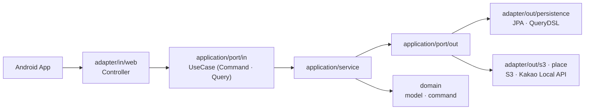

# 🎬 re:cord — Backend

하루 1분 이내의 영상을 **캘린더 기반 영상 다이어리**로 기록하는 Android 앱 **re:cord**의 백엔드 API 서버입니다.
기획 · 디자인 · Android · Backend 10명이 함께 만들었고, Google Play에 출시해 운영하고 있습니다.

| 구분 | 내용 |
| --- | --- |
| 서비스 | 1분 이내 영상 기록 · 캘린더/보드/북마크 조회 · 장소·BGM 지정 |
| 팀 | 10명 (기획 2 · 디자인 2 · Android 3 · Backend 3) |
| 운영 | Google Play 출시(2026.05) · 2026.08 기준 누적 다운로드 95, 월간 활성 사용자 35 |
| 스택 | Java 21 · Spring Boot 3.5.6 · Spring Data JPA · QueryDSL · MySQL · Redis · AWS S3 · Docker · GitHub Actions · AWS EC2 |

---

## 이 저장소에서 보여주고 싶은 것

1. **측정 가능한 쿼리 튜닝** — 캘린더 조회 `8.79ms → 0.69ms` ([상세](#1-캘린더-요약-api--복합-인덱스))
2. **UX에 맞춘 페이징 선택** — 무한 스크롤 보드/북마크에 3-키 커서 페이징 ([상세](#2-보드북마크-목록--커서-페이징))
3. **규모에 맞는 아키텍처 판단** — 헥사고날을 "필요한 만큼만" 적용 ([상세](#3-헥사고날-아키텍처--선택적-적용))
4. **Android 팀과의 협업** — API 문서에 호출 순서까지 명시 ([상세](#협업))

---

## 1. 캘린더 요약 API · 복합 인덱스

**요구사항** — 캘린더 화면은 날짜 범위(약 40일)의 각 날짜마다 ① 영상 개수 ② 가장 최근 영상의 썸네일을 한 번에 필요로 합니다. (`GET /v1/videos/summary`)

**문제** — `user_id` + 기간으로 필터링해 `GROUP BY user_defined_date`로 `COUNT` / `MAX(created_at)`를 구한 뒤, 원본 테이블과 JOIN해 "날짜별 최신 1건"을 찾는 쿼리가 **Full Table Scan**이었습니다.

```sql
SELECT v.user_defined_date, v.thumbnail_url AS latestThumbnail, t.cnt AS count
FROM video_edit v
INNER JOIN (
    SELECT user_defined_date, COUNT(*) AS cnt, MAX(created_at) AS latestCreatedAt
    FROM video_edit
    WHERE user_id = :userId AND user_defined_date BETWEEN :startDate AND :endDate
    GROUP BY user_defined_date
) t ON v.user_defined_date = t.user_defined_date AND v.created_at = t.latestCreatedAt
WHERE v.user_id = :userId AND v.user_defined_date BETWEEN :startDate AND :endDate
ORDER BY v.user_defined_date DESC;
```

**해결** — 쿼리의 접근 패턴(`user_id` 동등 → `user_defined_date` 범위 → `created_at` 집계)에 맞춰 복합 인덱스를 설계했습니다.

```java
@Index(name = "idx_video_daily_summary",
       columnList = "user_id, user_defined_date DESC, created_at DESC")
```

| | Before | After |
| --- | --- | --- |
| 집계 서브쿼리 접근 방식 | Full Table Scan | **Covering Index Range Scan** |
| 쿼리 실행 시간 | 8.79 ms | **0.69 ms (약 92% 감소)** |
| 서브쿼리 스캔 행 수 | 10,000 | **1,098** |

> 측정 조건: `EXPLAIN ANALYZE` 기준, 10,000건 데이터 · 40일 범위 조회.

**트레이드오프** — 지금 규모에서는 이 쿼리와 인덱스로 충분하다고 판단해 집계 테이블 같은 구조 변경은 미뤘습니다. 사용량이 늘면 테이블 분리 / 일 단위 집계 테이블 도입을 검토합니다. (코드 주석에도 같은 기준을 남겼습니다.)

## 2. 보드·북마크 목록 · 커서 페이징

**요구사항** — 사용자가 위·아래로 스크롤하며 과거/최근 영상을 이어서 보는 **무한 스크롤** 화면.

**선택** — `OFFSET` 페이징 대신 **커서(keyset) 페이징**을 적용했습니다.

- 정렬 키 `(user_defined_date, created_at, id)` 3개를 커서로 사용 — 같은 날짜·같은 생성 시각이 겹쳐도 `id`로 순서가 안정적입니다.
- `INIT`(기준 날짜 이전부터) / `DOWN`(더 과거) / `UP`(더 최신) **양방향 스크롤** 지원. `UP`은 오름차순으로 조회한 뒤 서비스에서 뒤집습니다.
- `hasNext` / `hasPrev`는 "마지막/첫 요소 기준으로 더 오래된/더 최신 데이터가 존재하는지"를 `LIMIT 1` 조회로 판단합니다.
- 보드·북마크 조회 인덱스: `(user_id, is_book_mark, user_defined_date DESC, created_at DESC, id DESC)`

**트레이드오프** — "3페이지로 바로 이동" 같은 **페이지 직접 이동을 포기**했습니다. 이 앱의 UX는 순차 무한 스크롤이라 이 제약이 문제되지 않는다고 판단했고, Android 팀과 스크롤 UX·날짜 조회 형식을 함께 회의해 확정했습니다.

## 3. 헥사고날 아키텍처 · 선택적 적용



- **적용한 것**: Port/Adapter 분리. 영상 썸네일 저장소(S3)처럼 **교체 가능성이 있는 외부 의존성**을 port 뒤로 숨겼습니다.
- **일부러 하지 않은 것**: UseCase를 기능 단위로 잘게 쪼개기, 도메인 이벤트 패턴 — MVP 규모에서는 오버엔지니어링이라고 판단했습니다. UseCase는 Command / Query 두 갈래로만 나눴습니다.
- 패턴을 목적이 아니라 **필요한 만큼의 도구**로 보는 관점입니다.

## 4. 도메인 규칙과 API

- 영상 길이 최대 60초, **하루 최대 5개** 등록, 본인 영상만 수정·삭제(소유권 검증).
- 영상 삭제 시 S3 썸네일도 함께 삭제.
- 인증: Kakao / Google 소셜 로그인(토큰 검증) → JWT access token + **Redis에 refresh token 저장**.
- 외부 연동: Kakao Local API(장소 검색, `WebClient`), S3 `bgm/` 폴더의 BGM 목록.

| Method | Path | 설명 |
| --- | --- | --- |
| `POST` | `/v1/videos` | 영상 등록 (multipart: 영상 정보 + 썸네일) |
| `GET` | `/v1/videos` | 보드 목록 (커서 페이징) |
| `GET` | `/v1/videos/bookmarks` | 북마크 목록 (커서 페이징) |
| `PATCH` | `/v1/videos/{id}/bookmark` | 북마크 토글 |
| `DELETE` | `/v1/videos/{id}` | 영상 삭제 (+ S3 썸네일) |
| `GET` | `/v1/videos/summary` | 캘린더 날짜별 요약 |
| `GET` | `/v1/videos/daily/{date}` | 특정 날짜 영상 목록 |
| `GET` | `/v1/videos/placeNames/search` | 키워드 장소 검색 |
| `GET` | `/v1/videos/bgms` | BGM 목록 |

전체 명세는 Swagger UI(`/swagger-ui/index.html`)에서 확인할 수 있습니다.

## 협업

- Swagger 문서만으로는 부족하다고 느껴, **API 호출 순서(선행 API)와 동작 방식**까지 설명해 Android 팀의 문의와 개발 지연을 줄이는 방향으로 문서를 보강했습니다.
- 커서 페이징의 UX(무한 스크롤 화면, 날짜 조회 형식)를 Android 팀과 함께 회의하며 조율했습니다.
- 개발 배경이 없는 기획팀원도 이해할 수 있도록 설명 방식을 바꿔가며 회의를 진행했습니다.

## 내 역할

- **영상(`videoEdit`) 도메인 전담**: 영상 CUD API, 캘린더 · 보드 · 북마크 조회 API 설계·구현
- 조회 패턴 분석 → 인덱스 설계 → `EXPLAIN ANALYZE` 검증
- Android 팀과의 API 계약(커서 페이징, 날짜 형식) 협의

## 시스템 구성 · 배포

```text
Android ─► Spring Boot (EC2, Docker) ─┬─► MySQL
                                       ├─► Redis (refresh token)
                                       └─► S3 (썸네일 · BGM)

GitHub Actions: main push → bootJar 빌드 → Docker 이미지 빌드·Docker Hub push → EC2 SSH 배포(docker compose)
```

- 환경 변수는 GitHub Secrets로 관리하고 배포 시 `.env`를 생성합니다.
- 수동 배포(`workflow_dispatch`)도 지원합니다.

## 실행 방법

```bash
# 1) 로컬 MySQL · Redis (포트 13306 / 16379)
docker compose up -d

# 2) 환경 변수 설정
#    MYSQL_URL, MYSQL_USERNAME, MYSQL_PASSWORD, REDIS_HOST, REDIS_PORT, REDIS_PASSWORD,
#    JWT_SECRET, JWT_ACCESS_TOKEN_EXPIRE_TIME, JWT_REFRESH_TOKEN_EXPIRE_TIME,
#    GOOGLE_CLIENT_ID, KAKAO_REST_API_KEY, AWS_ACCESS_KEY, AWS_SECRET_KEY, AWS_S3_BUCKET

# 3) 실행
./gradlew bootRun
```

## 한계와 개선 여지

- **하루 5개 제한은 check-then-act**: 개수를 조회한 뒤 저장하므로 같은 사용자의 동시 요청에서는 이론상 초과 저장이 가능합니다. Unique 제약이나 락 같은 방어가 없습니다. ([Music Place](https://github.com/jucheolkang/Music-Place_backend)에서 같은 유형의 문제를 재현·해결한 경험이 있습니다.)
- **테스트**: 현재는 컨텍스트 로딩 테스트 1건뿐이라, 커서 페이징 경계 조건과 소유권 검증이 자동 검증되지 않습니다.
- **리텐션**: 신규 유입 대비 반복 사용 비율이 낮은 것이 현재의 서비스 과제입니다.
